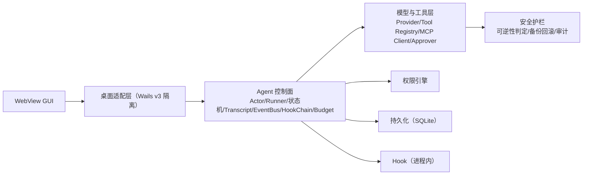

# 01-总览：定位、架构与边界

- 状态：定稿（2026-10-30，所有者放行开工）
- 日期：2026-10-30
- 关联：[ADR-0001](../adr/ADR-0001-adopt-go-wails3.md) ~ [ADR-0006](../adr/ADR-0006-license-mit.md)；本目录 [02](02-core-loop-and-data.md)、[03](03-permission-and-approval.md)、[04](04-security-and-hooks.md)；[roadmap](../roadmap/00-roadmap.md)
- 取代：`briefs/`《Go + Wails 3 桌面端 Agent 设计方案 v2》——v3 修订依据见 [research/01](../research/01-v2-design-review.md)

## 定位与职责

HappyWork 是一个**本地优先的受控桌面 AI Agent**：用户输入任务、选择工作区与模型、审批关键操作、查看过程与结果。一句话职责：**在最小权限与人工审批约束下，替用户完成本地任务范围内的确定性工作**。

目标用户：本地任务范围内、愿意为每次关键操作负责的桌面用户。典型任务："读取这个目录并生成摘要""把这张表整理后给我可审阅的变更""查询服务并用结果写草稿"。

**负范围（明确不做，纳入须先写 ADR）**：自动代码编辑与后台守护；无需确认的写文件、shell 与凭据调用；跨会话永久记忆；不受限互联网访问；插件热加载、远程代码执行与第三方插件商店；移动端承诺（Wails v3 移动端尚为实验性）。

### 能力边界

| 能力 | MVP | 后续阶段 | 说明 |
|---|---|---|---|
| 单会话 Agent 循环 | ✅ | 多会话并行 | 先证明取消、审批与恢复 |
| 本地工具（少量） | ✅ | 工具市场 | 控制 blast radius |
| MCP 客户端（stdio） | ✅ | 远程 MCP | 远程需 TLS + 认证 |
| 人工确认 | ✅ | 策略规则持久化 | 信任边界不可省略 |
| SQLite transcript | ✅ | 可插拔存储 | 单文件易迁移 |
| 进程内 Hook | ✅ | 外部进程 Hook | 外部形态见 [04](04-security-and-hooks.md) §Hook |
| 前端渲染安全基线 | ✅ | CSP 细化 | 攻击面最后一公里，不可推迟 |
| 子 Agent / 计划模式 | ❌ | 条件启用 | 增加状态与授权复杂度 |
| 后台常驻 / 远程插件 | ❌ | 后续评估 | 无人值守风险 |

## 设计哲学（四条不可妥协）

> 核心原则：**以最小权限和降低犯错成本为中心，而不是追求完美拦截**。追求"识别所有危险"的系统会漏判或误拦——用户疲劳后一路点"允许"才是真正的权限坍塌。

1. **确定性控制循环**：模型只做"理解模糊、做选择、组织语言"；任务拆解、审批节点、异常分支用确定性代码跑。
2. **上下文工程 > Prompt 技巧**：模型能看见什么比怎么问它更重要（见 [02](02-core-loop-and-data.md) §上下文窗口管理）。
3. **犯错代价最小化**：事前最小权限 → 事中隔离 + 人工确认 → 事后备份回滚 + 不可变审计，逐级兜底。
4. **可逆性优先**：判断工具风险先看"错了能不能撤销"，再看"需不需要审批"。不可逆副作用（发邮件、推远端、删数据）才是真正的高危，备份救不了它们。

## 模块划分（六层架构）

**核心是一份不可被 GUI 直接绕过的控制面。** GUI 只调用服务暴露的命令、订阅事件；模型、工具、审批与持久化全在 Go 侧。服务间通过构造函数注入依赖，不用全局变量共享可变状态。



| 层 | 职责 |
|---|---|
| 1 桌面适配层 | 窗口生命周期、服务注册、事件批量 flush、生成 TS 绑定；Wails 调用收敛到少数文件 |
| 2 Agent 控制面 | Session Actor、Runner 循环、状态机、Transcript、EventBus、HookChain、Budget |
| 3 模型与工具层 | Provider（Chat/Stream）、Tool Registry、MCP Client、Approver |
| 4 持久化层 | SQLite：sessions / messages / tool_calls / approvals / events / kv |
| 5 扩展层 | 进程内 Hook（MVP）；外部进程 Hook、沙箱执行器（后续阶段） |
| 6 安全护栏层 | 权限引擎、Confirm-then-Act、可逆性判定、备份回滚、不可变审计 |

`main.go` 只装配，不实现策略。配置、密钥、业务数据库三者分开；敏感凭据只存系统钥匙串或由用户环境变量注入。

### 包依赖方向（防循环）

```
desktop → agent → {model, tool, permission, storage, hook, audit}
tool    → permission        // 单向依赖；permission 不 import tool
sandbox / snapshot / audit  // 叶子包，不反向依赖
```

## 关键设计与约束

1. **控制面不可绕过**：GUI → 适配层 → 控制面是唯一通道；任何工具执行、状态推进必须经过权限引擎与审批管道（[03](03-permission-and-approval.md)、[04](04-security-and-hooks.md)）。
2. **transcript 是事实源，UI 状态是派生视图**：会话恢复依赖 transcript 重放，不依赖 UI 缓存。
3. **工具执行串行（MVP）**：同一会话的工具调用严格串行；并行须独立安全评审 + 依赖图（见 [02](02-core-loop-and-data.md)）。
4. **接缝 1 · Wails 适配层**：所有 Wails API 调用收敛在 `internal/desktop/`，框架升级/回退只改这一层；适配层接口见 [02](02-core-loop-and-data.md) §适配层。
5. **接缝 2 · Provider 抽象**：`model/provider.go` 只暴露统一的 Chat/Stream 接口，function-calling 格式在实现内归一化；新增 provider 不动控制面。
6. **接缝 3 · 存储可替换**：控制面依赖 `storage` 接口而非 SQLite 本体；将来可插拔存储只动持久化层。
7. **接缝 4 · Hook 形态**：Hook 接口与进程内实现解耦；外部进程形态以同一接口接入（[04](04-security-and-hooks.md)）。

### 技术事实与版本策略

| 事实 | 影响 |
|---|---|
| Wails **v3.0.0 已于 2026-09 转正**（桌面三平台 stable；移动端实验性） | 框架风险大降；仍钉 minor 版本 + 适配层隔离（[ADR-0001](../adr/ADR-0001-adopt-go-wails3.md)） |
| Wails v3 要求 **Go 1.26+** | 工具链基线写入 [standards/04](../standards/04-coding.md) |
| WebView 差异：Windows WebView2 / macOS WKWebView / Linux webkitgtk | 渲染安全基线必须三平台一致验证；Linux 打包依赖 webkitgtk |
| 三平台 OS 沙箱能力差异极大（Seatbelt / Landlock / AppContainer） | 沙箱按平台分期落地（[ADR-0005](../adr/ADR-0005-mvp-security-downgrade.md)、[04](04-security-and-hooks.md)） |

### 代码目录骨架（对应 [standards/01](../standards/01-repo-structure.md) §2 自定义布局）

```
cmd/agent/main.go              # 只装配
internal/
  agent/      actor, runner, state, transcript, events, budget, context
  model/      provider.go
  tool/       registry, local, executor, approval, meta
  permission/ engine, policy, canonpath        ← 权限引擎（不 import tool）
  sandbox/    interface, macos, linux, windows （Phase 5 起）
  rollback/   backup, checkpoint               ← 备份式回滚（取代 v2 快照）
  audit/      logger, sealer
  mcp/        client, session, whitelist, lifecycle
  hook/       interface, chain, loader          （process 形态后续阶段）
  storage/    sqlite, migrate
  secrets/    store.go
  desktop/    platform, bridge, flush           ← Wails 适配层
  singleinst/ lock.go
frontend/                      # WebView 前端（框架待决策，见 roadmap）
migrations/                    # SQL 迁移
```

## 与 roadmap 的映射

| 阶段 | 主题 | 对应架构篇 |
|---|---|---|
| Phase 1 | 最小骨架（Wails 壳 + SQLite + mock 模型 + read_file） | 01、02 |
| Phase 2 | 受控执行闭环（Actor + 工具 + MCP stdio + 审批 + 渲染安全） | 02、03、04 |
| Phase 3 | 权限引擎 + 进程内 Hook + TOCTOU 管道 | 03、04 |
| Phase 4 | 安全加固 a：审计 + 备份回滚 + 三平台签名 CI | 04 |
| Phase 5 | 安全加固 b：OS 沙箱（macOS/Linux 先行） | 04 |

## 风险与待决

| 风险 | 对策 | 详见 |
|---|---|---|
| Wails 升级改变行为 | 钉版本、适配层、矩阵测试 | [ADR-0001](../adr/ADR-0001-adopt-go-wails3.md) |
| 提示注入诱导工具调用 | 来源隔离、路径规范化、渲染层拦截 | 03、04 |
| 审批疲劳 → 权限坍塌 | 双指纹作用域、三级弹窗 | 03 |
| 审批后参数漂移 | TOCTOU 管道 + JCS hash 锁定 | 04 |
| SQLite 损坏 / 双实例 | 单写者、WAL、在线备份、单实例锁 | 02、04 |

待决：ML 分类器作为决策维度实现方式（Backlog）。已定：前端 React + TS（[ADR-0007](../adr/ADR-0007-frontend-react.md)）；真机测试 Provider DeepSeek（[ADR-0008](../adr/ADR-0008-deepseek-test-provider.md)，Phase 2 接入）；UI 信息结构参照 ZCode（[ADR-0009](../adr/ADR-0009-zcode-ui-reference.md)）。
