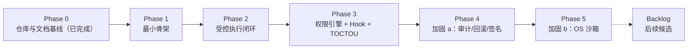

# 路线图：总览

- 状态：定稿（2026-10-30）
- 日期：2026-10-30
- 关联：[ADR-0001](../adr/ADR-0001-adopt-go-wails3.md) ~ [ADR-0005](../adr/ADR-0005-mvp-security-downgrade.md)；[architecture/01](../architecture/01-overview.md) §与 roadmap 的映射

## 1. 阶段总览与看板（本表是**唯一进度看板**）

> README（中英两份）不重复看板；阶段状态只在本表维护。状态变更必须同步 CHANGELOG 与 `.agents/CONTEXT.md`。**最近更新：2026-10-30。**

| 阶段 | 一句话目标 | 参考估时* | 状态 |
|---|---|---|---|
| Phase 0 | 仓库初始化、V3 设计基线、治理规范落盘 | — | ✅ 完成（2026-10-30） |
| [Phase 1](phase-1-minimal-skeleton.md) | 最小骨架：Wails 壳 + SQLite + mock 模型 + 只读工具 + 单实例锁 | 1~2 周 | ✅ 完成（2026-10-30，tag `phase-1.end`；[报告](../design/phase-1/report.md)） |
| Phase 2 | 受控执行闭环：Actor + 本地工具 + MCP stdio + 四维审批 + 渲染安全 | 2~3 周 | 未开始 |
| Phase 3 | 权限引擎（映射表/双指纹/路径规范化）+ 进程内 Hook + TOCTOU 管道 | 2 周 | 未开始 |
| Phase 4 | 加固 a：不可变审计 + 备份式回滚 + 三平台签名 CI | 2 周 | 未开始 |
| Phase 5 | 加固 b：OS 沙箱（macOS Seatbelt + Linux Landlock） | 3~6 周 | 未开始 |

\* 单人参考值，仅量级感知。状态取值：未开始 / 进行中 / ✅ 完成（日期 + tag）。

> 阶段文档命名：`phase-N-短主题.md`；阶段状态行变更即更新本表。Phase 2~5 的阶段文档在该阶段立项时创建。

## 2. 每阶段通用流程（硬流程，详见 standards/07）

1. **文档定稿**：本阶段 phase 文档及其引用设计稿（`docs/design/phase-N/`）从草稿转定稿（所有者知情即可，重大技术变更须 ADR）。
2. **实现**：feature 分支开发；规范全程生效。
3. **验收**：逐条执行本阶段"验收场景"，结果写入《阶段进度报告》（`design/phase-N/report.md`）。
4. **收尾**：进度报告 + 更新本看板 + CHANGELOG + ADR/架构文档回填 + 打 tag（`phase-N.end`）。

## 3. Backlog（后续阶段候选，立项须先写 ADR）

- 外部进程 Hook（进程隔离 + JSON-RPC + 资源限制）——触发：进程内 Hook 生态成熟、出现不可信扩展需求
- Windows AppContainer 沙箱——触发：Phase 5 完成且 Windows 用户占比明确（独立 ADR + 安全评审）
- 完整文件系统快照（增量、跨平台）——触发：备份式回滚被证明不够用
- 远程 MCP（TLS + 认证）——触发：本地 MCP 验证完成
- 子 Agent / 计划模式 / 后台任务 / 工具并行执行——触发：单会话循环稳定后独立安全评审
- ML 分类器作为决策维度实现——触发：审批数据积累足够
- 多会话并行 / 工具市场——产品化阶段评估
- UI/UX 精修（布局精修 + 视觉 + 主题）——触发：Phase 2 验收通过、审批弹窗与 transcript 信息结构冻结；此前各阶段前端一律"灰盒"（默认样式、零视觉投入，但审批弹窗/来源标记的信息完整性是安全基线不降级）

## 4. 风险登记簿（跨阶段）

| 风险 | 等级 | 对策 |
|---|---|---|
| Wails 升级破坏行为 | 中 | 钉版本 + 适配层隔离 + 三平台矩阵测试（ADR-0001） |
| 提示注入诱导工具调用 | 高 | 来源隔离 + 路径规范化 + 渲染层拦截（architecture/03、04） |
| 审批疲劳 → 权限坍塌 | 高 | 双指纹作用域 + 三级弹窗 + 按可逆性分级（ADR-0003） |
| 无沙箱期（Phase 1–4）本地破坏 | 中 | 权限 + 审批 + 备份三重兜底；shell/删除默认 deny（ADR-0005） |
| MCP 返回恶意 schema / 子进程僵尸 | 中 | schema 白名单 + 生命周期管理 + 重启上限 |
| SQLite 损坏 / 双实例 | 中 | 单写者 + WAL + 在线备份 + 单实例锁 |
| 上下文超窗导致长会话失败 | 中 | 组装预算 + 分级折叠（architecture/02 §上下文窗口管理） |
| Linux webkitgtk 分发依赖 | 低 | Phase 1 验证三平台打包；AppImage/deb 评估 |
